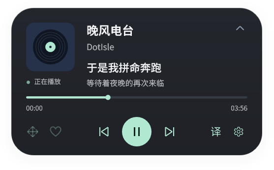
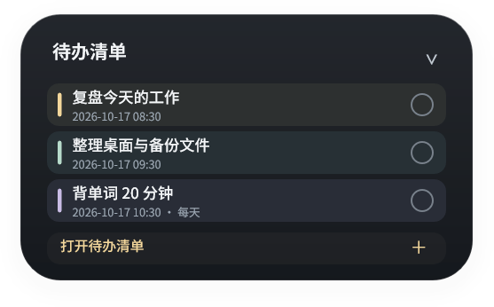
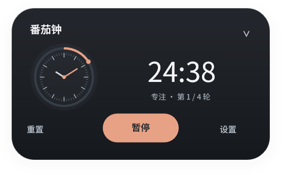
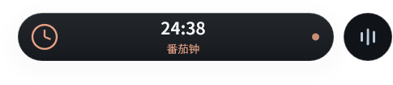

# 点屿 · DotIsle

**Windows 桌面的灵动岛，让音乐、消息与日常事项停留在一眼可见的地方。**

音乐歌词 · 通知提醒 · 待办清单 · 番茄钟 · 倒计时 · 秒表 · 设备连接

[下载正式版](https://github.com/Heiamer/LyricIsland/releases/latest) · [更新日志](CHANGELOG.md) · [反馈问题](https://github.com/Heiamer/LyricIsland/issues)

## 认识点屿

点屿从歌词岛发展而来。收起时是一枚轻巧的胶囊，展开后显示当前活动的完整卡片：听歌时查看歌词与控制播放，专注时查看计时，日常使用时接收消息、待办和设备提醒。

多个活动同时存在时，胶囊旁会出现同高的圆形组件。点击它可以切换活动，也可以开启左右拖动切换；收起后会保留当前选中的界面。

下面是程序原生渲染的演示画面：

| 音乐与歌词 | 待办清单 |
| :---: | :---: |
|  |  |

| 计时器 | 收起胶囊与副组件 |
| :---: | :---: |
|  |  |

## 下载与开始使用

适用于 **Windows 10 / 11 x64**。

| 文件 | 使用方式 |
| --- | --- |
| [DotIsle-1.3.exe](https://github.com/Heiamer/LyricIsland/releases/download/v1.3/DotIsle-1.3.exe) | 单文件启动包，运行后自动释放完整组件并启动。 |
| [DotIsle-1.3-Portable.zip](https://github.com/Heiamer/LyricIsland/releases/download/v1.3/DotIsle-1.3-Portable.zip) | 完整解压到可写目录，再运行其中的 `LyricIsland.exe`。 |
| [DotIsle-1.3-Source.zip](https://github.com/Heiamer/LyricIsland/releases/download/v1.3/DotIsle-1.3-Source.zip) | 对应 1.3 正式版提交的源码。 |

1. 启动后，通过系统托盘打开设置。
2. 打开播放器并播放音乐，胶囊会显示当前歌词；点击胶囊可展开。
3. 在设置中添加待办、创建计时器，或按需开启通知与设备提醒。

程序随包提供中文、日文字体和 SQLite，无需另行安装字体或通知证书。分享应用时请发送完整启动包或便携 ZIP。

### 老版本 OTA 更新

**1.2.1 / 1.2.2 用户**可以在「设置 → 关于与更新」检查版本，点击「下载并更新」。程序会下载并校验更新包，在原运行目录替换文件、保留 `Data` 和 `Logs`，随后自动重启。写入失败时会尝试恢复备份。

发行页保留的 `LyricIsland-1.3-Portable.zip` 和 `LyricIsland-1.3-SHA256.txt` 专供旧更新器使用，与 DotIsle 便携包内容一致。产品已更名，内部程序文件名、配置与更新标识继续兼容旧版本，因此仓库地址暂时沿用 LyricIsland。

如果正在使用同为 **1.3** 的早期测试包，版本比较不会发现变化，请先退出测试版，再运行正式启动包。从 1.2 升级时需先运行一次支持 OTA 的版本。

## 可以做什么

### 音乐与歌词

- 显示封面、歌名、歌手、播放进度，提供播放/暂停、上一首、下一首等控制。
- 有翻译时上下两行显示原文与译文；中文双行模式可在当前句下方显示下一句。
- 歌词长度可驱动胶囊宽度平滑变化，并单独设置宽度上限。
- 根据封面为展开卡片、控制组件、进度条与状态点取色，压低背景亮度以保证文字可读。
- 播放状态点采用呼吸效果；可独立设置点击封面或歌名跳转播放器。
- 默认允许网易云音乐、QQ 音乐、酷狗、酷我、Spotify 和 Twilight Echo，也可设置自定义播放器来源。实际控制能力取决于播放器提供的 Windows 媒体接口。

### 通知与设备

- 在灵动岛显示新通知，支持队列、暂停提醒、可选应用白名单，以及点击通知跳转来源应用。
- 通知接收采用免证书方式，无需注册额外通知身份组件。
- 可开启 U 盘、USB 与便携设备连接/移除提醒。
- 「通知与设备」页提供 **U 盘连接、手机连接、设备移除** 三种测试弹窗，无需插入真实硬件。

### 待办与计时

- 待办支持标题、内容、日期、时间、每日重复、完成勾选与编辑删除。
- 按全部、进行中、已过期、今天、最近 7 天筛选，支持马卡龙配色和已完成项目收起。
- 待办偏好通过独立齿轮入口调整，到期时通过灵动岛提醒。
- 番茄钟、倒计时和秒表使用刻度表盘，可同时保留多个独立计时；重启后保留进度并暂停。

### 外观、交互与声音

- 设置窗口支持浅色、深色和跟随系统，标题栏与内容区域采用统一样式。
- 收起胶囊和展开卡片均可按住内容区左右拖动切换活动；播放按钮和进度条保留各自操作。
- 音效集中设置，通知、待办与计时器、设备分别调节音量、试听，并可选用自定义本地 PCM WAV。
- 内置短音为原创合成，不使用 Apple 原版提示音录音。

## 默认开关

已有配置会保留，新默认值不会强行覆盖个人选择。

| 选项 | 新配置默认值 |
| --- | --- |
| 点击胶囊任意区域展开 | 开启 |
| 胶囊显示歌词翻译 | 开启 |
| 封面取色 | 开启 |
| 在线补全网易云歌曲信息 | 开启 |
| 点击通知跳转来源应用 | 开启 |
| 中文下一句双行模式 | 关闭 |
| 歌词长度自适应宽度 | 关闭；开启后显示上限设置 |
| 左右拖动切换活动 | 关闭，在「灵动岛」页开启 |
| 应用通知 / 通知白名单 / 暂停通知 | 均关闭 |
| 设备连接提醒 / 音乐点击跳转播放器 | 均关闭 |
| 开机启动 / 悬停展开 | 均关闭 |

## 数据与使用说明

- 设置、待办和计时数据保存在运行目录的 `Data` 中，升级时保留。待办提醒需要程序保持运行；关闭后不会在后台唤醒，每日待办只检查当天的提醒。
- 通知接收只读当前 Windows 用户的通知存储，不修改通知数据库或上传通知正文；不同系统版本、权限和数据库占用情况可能影响接收。
- 手机需被 Windows 识别为便携设备，例如 MTP 模式；仅充电连接不能保证识别。实体 USB / 手机插拔尚未完成覆盖测试。
- 更多细节见[使用说明](NATIVE-README.md)。遇到问题时，可在 [Issues](https://github.com/Heiamer/LyricIsland/issues) 中附上系统版本、应用版本和复现步骤。

## 开发与开源

主程序采用 **Rust、Win32、Direct2D、DirectWrite、DirectComposition**，设置界面使用 **GPUI**。构建方法见[构建文档](docs/BUILDING.md)，测试与发布历史见[更新日志](CHANGELOG.md)。

代码许可见 [LICENSE](LICENSE)。第三方来源、字体和组件许可见 [THIRD-PARTY-NOTICES.md](THIRD-PARTY-NOTICES.md)、[FONT-NOTICE.md](FONT-NOTICE.md) 与 [licenses](licenses)。
