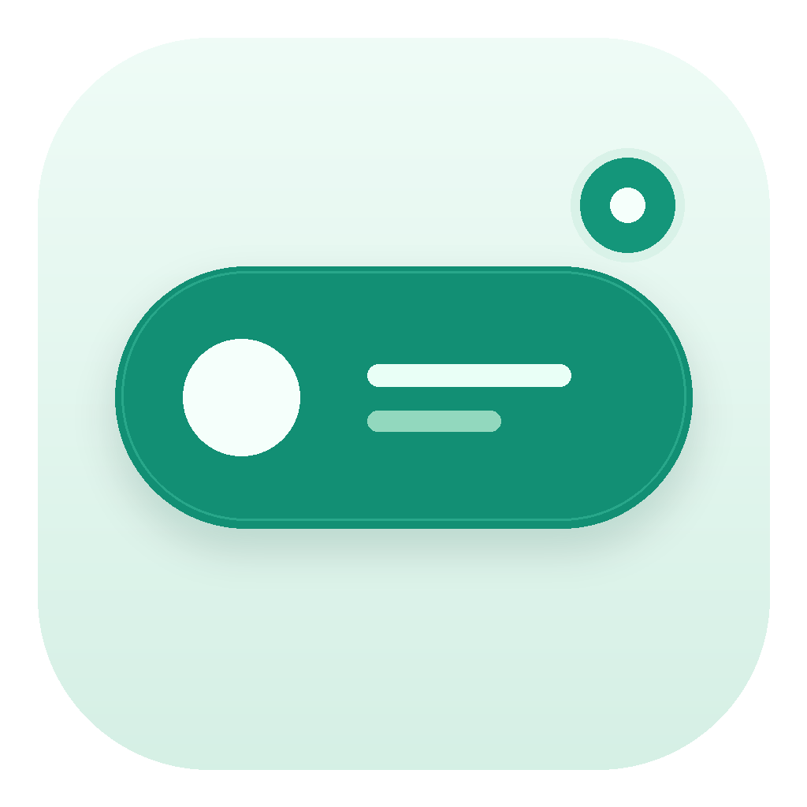

<div align="center">



# 点屿 · DotIsle

**Windows 桌面的灵动岛，把音乐、歌词、专注与提醒放在一眼可见的地方。**

音乐歌词 · 通知与设备 · 待办清单 · 番茄钟 · 倒计时 · 秒表

[下载 3.1.1 正式版](https://github.com/Heiamer/LyricIsland/releases/download/v3.1.1/DotIsle-3.1.1-Portable.zip) · [本版更新说明](https://github.com/Heiamer/LyricIsland/releases/download/v3.1.1/DotIsle-3.1.1-Notes.md) · [反馈问题](https://github.com/Heiamer/LyricIsland/issues)

</div>

## 3.1.1 更新

- **混合渲染**：主岛、控制中心和更新窗口采用 Vello Hybrid；CPU 处理路径，GPU 完成绘制与合成。
- **更轻的资源管理**：设置按需启动，关闭一分钟后退出；字体使用文件映射，图片与 GPU 资源按需分配和复用。
- **更紧凑的沉浸歌词**：移除歌名旁的小封面，保留磨砂取色背景；当前歌词采用中等字重，翻译和前后句按内容紧凑排列。
- **悬停才显示操作**：鼠标进入音乐卡片后显示进度和播放按钮，离开后回归歌词；拖动进度时保留操作，外框不跳动。
- **有形变的交互反馈**：侧栏指示跟随、选项圆角与勾选过渡、开关拇指和颜色切换、按钮按压及播放按钮形变；支持快速反向和减少动态效果。
- **细节修正**：播放状态点按文字字形中心对齐，动态色板的色点与标签共用列中心；概览音乐卡片显示当前歌词。

## 界面预览

以下为程序原生渲染的演示画面，歌曲与歌词为示例数据。


## 下载与开始使用

适用于 **Windows 10 / 11 x64**。运行时不需要安装 Rust、Python 或 .NET。

| 文件 | 用途 |
| --- | --- |
| [DotIsle-3.1.1-Portable.zip](https://github.com/Heiamer/LyricIsland/releases/download/v3.1.1/DotIsle-3.1.1-Portable.zip) | 推荐下载。解压完整目录后运行 `LyricIsland.exe`。 |
| [DotIsle-3.1.1-Source.zip](https://github.com/Heiamer/LyricIsland/releases/download/v3.1.1/DotIsle-3.1.1-Source.zip) | 与本轮构建对应的完整源码、字体、许可证和构建文档。 |
| [DotIsle-3.1.1-SHA256.txt](https://github.com/Heiamer/LyricIsland/releases/download/v3.1.1/DotIsle-3.1.1-SHA256.txt) | 交付文件的 SHA256 校验值。 |
| [DotIsle-3.1.1-Validation.zip](https://github.com/Heiamer/LyricIsland/releases/download/v3.1.1/DotIsle-3.1.1-Validation.zip) | 测试报告、原生渲染截图和打包验收结果。 |

1. 将便携 ZIP **完整解压到可写目录**，不要在压缩包中直接启动 EXE。
2. 运行 `LyricIsland.exe`，通过系统托盘打开控制中心。
3. 打开播放器并播放音乐，点屿会尝试连接 Windows 媒体会话并显示歌词。
4. 在“灵动岛 → 音乐卡片 → 展开排版”选择沉浸歌词；其他布局继续保留。
5. 在“设置 → 外观”调整动态色彩、明暗主题和减少动态效果。

请保留 EXE 旁的 `Assets`、字体、更新助手和许可证。需要迁移旧数据时，先退出旧程序，再把原运行目录的 `Data` 复制到新目录；请先备份，不要同时运行两个版本操作同一份数据。

### 从旧版更新

发行页同时提供 `LyricIsland-3.1.1-Portable.zip` 与 `LyricIsland-3.1.1-SHA256.txt`，供旧版更新器识别。兼容包使用旧更新器要求的目录名，内部运行文件与推荐便携包相同。

可以从旧版的“关于与更新”检查更新；网络或旧更新器无法完成升级时，请手动下载推荐便携包，退出旧程序后再迁移 `Data`。本次只发布 GitHub，国内镜像不保证同步更新。

## 日常功能

- **音乐与歌词**：播放/暂停、上一首/下一首、播放进度、原文与翻译、多种展开排版及封面动态色彩。实际控制能力取决于播放器的媒体会话接口。
- **专注与计时**：番茄钟、倒计时、秒表和工作流计时；支持多计时项目和暂停恢复。
- **待办**：记录事项、编辑、完成、撤销及日期时间提醒。
- **通知与设备**：在岛体中展示通知与连接状态；能力受 Windows 版本、权限及设备接口影响。
- **外观与交互**：控制中心与灵动岛分别保存配色和材质，胶囊与展开卡片圆角可独立设置。

关闭控制中心后，主岛继续运行。完全退出主程序后，不再提供计时和待办提醒。

## 性能与验证

本轮通过 **435 项 workspace 测试、10 组原生 IPC 集成检查、112 张设置场景截图与 65 张沉浸卡片截图**，并从最终 ZIP 解压验证程序、字体、更新助手和文件校验。

优化包括收紧 GPU 数据纹理与分配块、去掉常驻中间画布、字体按需映射、复用着色器缓存、设置延迟启动与隐藏后退出。内存会随页面、缩放、显卡和使用时间变化，**不承诺设置窗口已达到 100 MB**。本轮 UI 改动没有重新进行同口径的可见窗口内存测量，也没有把旧测量值当作新版实测。

真实播放器、IME、桌面关闭/热重开的本轮人工交互验收仍待补充；离屏渲染和隔离状态检查不能替代这些验收。具体范围见[本版说明](https://github.com/Heiamer/LyricIsland/releases/download/v3.1.1/DotIsle-3.1.1-Notes.md)。

## 源码与构建

当前运行栈为 **Rust、Win32、Vello Hybrid、wgpu 和 Parley**，控制中心使用同一套原生绘图技术。

本次选择以 Release 附件交付完整源码；**请下载 `DotIsle-3.1.1-Source.zip`**，其中 `BUILD-3.1.1.md` 说明工具链和构建步骤。仓库主分支与 GitHub 自动生成的 “Source code” 归档不作为本轮二进制的对应源码；本轮没有全量同步主分支代码。

```powershell
powershell -NoProfile -ExecutionPolicy Bypass -File tools/li-cargo.ps1 build --release --package lyric-native --package dotisle-app --package lyric-bootstrap
powershell -NoProfile -ExecutionPolicy Bypass -File tools/li-cargo.ps1 test --workspace --release
```

构建所需工具仅用于开发，不需要随程序安装。源码包保留当前使用的第三方补丁和许可证，不包含用户 `Data` 或编译 `target`。

## 许可与反馈

许可见 [LICENSE](LICENSE)，第三方与字体说明见 [THIRD-PARTY-NOTICES.md](THIRD-PARTY-NOTICES.md)、[FONT-NOTICE.md](FONT-NOTICE.md)。反馈时请附 Windows 版本、应用版本、复现步骤和相关日志，并先移除个人信息。
